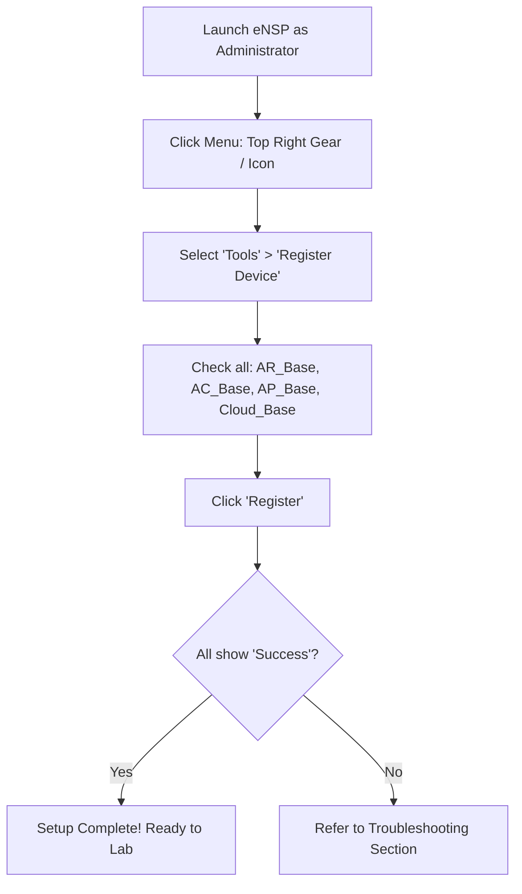

<div align="center">


# 🛠️ Complete Huawei eNSP Installation & Setup Guide
### *Tested & Working on Windows 10 and Windows 11*

[](https://microsoft.com)
[-orange?style=for-the-badge&logo=virtualbox&logoColor=white)](https://www.virtualbox.org/wiki/Download_Old_Builds_5_2)
[](https://e.huawei.com)
[](#-troubleshooting--common-errors)

---

</div>

## 📖 Introduction

**Huawei eNSP (Enterprise Network Simulation Platform)** is an official graphical network simulation tool from Huawei. It emulates Huawei enterprise routers (AR series), switches (S-series), firewalls (USG series), and WLAN controllers/access points.

> [!WARNING]
> Huawei eNSP depends strictly on specific versions of **VirtualBox**, **WinPcap**, and **Wireshark**. Installing newer versions of VirtualBox (such as 6.x or 7.x) will cause AR routers to fail with infinite `###` or **Error Code 40**. 
> Follow this guide carefully to ensure a 100% working setup on both **Windows 10** and **Windows 11**.

---

## 📦 Required Software Matrix

Download and install the components in the exact order listed below:

| Sequence | Software Component | Required Version | Purpose |
| :---: | :--- | :---: | :--- |
| **1** | **WinPcap** | `4.1.3` | Low-level packet capture driver |
| **2** | **Wireshark** | `3.x` (or `4.x`) | Packet analysis and capture tool |
| **3** | **Oracle VM VirtualBox** | **`5.2.44`** *(Mandatory)* | Virtualization engine for router & firewall images |
| **4** | **Huawei eNSP** | `V100R003C00SPC100`<br/>(v1.3.00.100) | Main eNSP Simulation Platform |

> [!IMPORTANT]
> **Do NOT install VirtualBox 6.x or 7.x!** 
> VirtualBox `5.2.44` is the final build of the 5.2 branch and is the most stable version compatible with Huawei AR/USG virtual machines.

---

## 🚀 Step-by-Step Installation Procedure

### Step 1: Install WinPcap
1. Run `WinPcap_4_1_3.exe` as Administrator.
2. Follow the standard installation wizard (Next &rarr; I Agree &rarr; Install &rarr; Finish).
3. If you already have **Npcap** installed (from Wireshark or Nmap), ensure **"Install Npcap in WinPcap API-compatible Mode"** is checked.

### Step 2: Install Wireshark
1. Run the Wireshark installer.
2. Accept the default options.
3. If prompted to install Npcap/WinPcap, uncheck it if WinPcap 4.1.3 was already installed in Step 1.

### Step 3: Install Oracle VM VirtualBox 5.2.44
1. Download `VirtualBox-5.2.44-139111-Win.exe`.
2. Right-click the installer and select **Run as Administrator**.
3. Accept default installation location (`C:\Program Files\Oracle\VirtualBox\`).
4. Allow the installation of network interfaces and drivers.
5. Finish installation and reboot your PC if prompted.

### Step 4: Install Huawei eNSP
1. Right-click `eNSP V100R003C00SPC100 Setup.exe` and select **Run as Administrator**.
2. Follow the on-screen prompts.
3. During the installation prerequisite check, ensure all green checkmarks appear for:
   - WinPcap
   - Wireshark
   - VirtualBox
4. Complete the installation.

---

## ⚙️ Critical Windows 10 / Windows 11 Configurations

Windows 10 (recent updates) and Windows 11 enable security features that block VirtualBox 5.2 drivers by default. You **must** verify the following settings:

### 1. Disable Memory Integrity (Core Isolation)
VirtualBox 5.2.44 drivers cannot load if Memory Integrity is enabled:
1. Open **Windows Security** (Search `Windows Security` in Start menu).
2. Go to **Device Security** &rarr; click **Core isolation details**.
3. Toggle **Memory integrity** to **`Off`**.
4. Restart your computer.

### 2. Disable Hyper-V & Windows Hypervisor Platform
Hyper-V conflicts with VirtualBox 5.2 hardware virtualization:
1. Press `Win + R`, type `optionalfeatures.exe`, and press **Enter**.
2. Uncheck the following options:
   - [ ] **Hyper-V** (all sub-features)
   - [ ] **Virtual Machine Platform**
   - [ ] **Windows Hypervisor Platform**
   - [ ] **Windows Sandbox**
3. Click **OK** and restart your computer.

### 3. Configure VirtualBox Host-Only Ethernet Adapter
1. Open **Oracle VM VirtualBox**.
2. Go to **File** &rarr; **Host Network Manager** (or press `Ctrl + W`).
3. Verify that `VirtualBox Host-Only Ethernet Adapter` exists with:
   - **IPv4 Address**: `192.168.56.1`
   - **IPv4 Network Mask**: `255.255.255.0`
   - **DHCP Server**: **`Disabled`** (Uncheck "Enable Server").

---

## 🎯 Device Registration in eNSP (Mandatory First Run)

Before building any topology, register the base virtual machine templates:



1. Launch **eNSP** as Administrator.
2. In the top toolbar, go to **Menu** &rarr; **Tools** &rarr; **Register Device**.
3. Select all checkmarks:
   - `AR_Base`
   - `AC_Base`
   - `AP_Base`
   - `Cloud_Base`
   - `Router_Base`
4. Click **Register**.
5. Wait until every item displays **"Registered successfully"**. Click **Exit**.

---

## 🔧 Troubleshooting & Common Errors

### 1. Problem: AR Router Shows Infinite `###...###` on Boot
This is the most common issue in eNSP. It means the virtual machine failed to exchange heartbeat packets with eNSP.

**Root Causes & Solutions:**
- **VirtualBox version is wrong**: Ensure you are using **VirtualBox 5.2.44**. If you have version 6.x or 7.x, uninstall it and install 5.2.44.
- **Corrupted Virtual Machines**:
  1. Close eNSP completely.
  2. Open **Oracle VM VirtualBox**.
  3. Delete all VMs named `AR_Clone_xxx` (Right-click &rarr; Remove &rarr; Delete all files).
  4. Ensure base VMs (`AR_Base`, etc.) remain intact.
  5. Open eNSP as Administrator, go to **Menu &rarr; Tools &rarr; Register Device**, select all, and re-register.
- **Firewall Blocking**:
  Add inbound and outbound firewall allow rules for:
  - `C:\Program Files\Huawei\eNSP\eNSP.exe`
  - `C:\Program Files\Huawei\eNSP\vboxserver\eNSP_VBoxServer.exe`
  - `C:\Program Files\Oracle\VirtualBox\VBoxHeadless.exe`

---

### 2. Problem: Error Code 40
**Meaning:** eNSP cannot connect to the VirtualBox Host-Only Ethernet Adapter.

**Solution:**
1. Close eNSP.
2. Open **Device Manager** (`devmgmt.msc`) &rarr; expand **Network adapters**.
3. Look for `VirtualBox Host-Only Ethernet Adapter`. If disabled, right-click and **Enable**.
4. If missing, open VirtualBox &rarr; **File** &rarr; **Host Network Manager** &rarr; click **Create** to create a new host-only adapter (`192.168.56.1/24`, DHCP disabled).
5. Launch eNSP as Administrator and re-register devices.

---

### 3. Problem: Error Code 41 / 45
**Meaning:** Hardware virtualization (VT-x for Intel / AMD-V for AMD) is disabled in your computer's BIOS/UEFI.

**Solution:**
1. Reboot your computer and enter BIOS/UEFI (usually press `F2`, `Del`, or `F12` during startup).
2. Look for **Intel Virtualization Technology (VT-x)** or **AMD-V / SVM Mode**.
3. Set to **Enabled**.
4. Save and reboot.

---

### 4. Problem: USG6000V Firewall Image Setup
The default eNSP installer does not bundle the heavy USG6000V image.

**How to load USG6000V:**
1. Download the `USG6000V.zip` / `USG6000V.vdi` image package.
2. In eNSP, drag a **USG6000V** device onto the canvas.
3. Right-click the USG6000V icon and select **Settings**.
4. In the dialog, browse and select the extracted `USG6000V.vdi` file.
5. Click **Import** / **Save**.
6. Start the device. Default login: `admin` / `Admin@123` (or `Huawei@123`).

---

## 🧪 Verification: Testing Your Setup

To confirm your installation works properly:

1. In eNSP, create a new lab (`Ctrl + N`).
2. Drag two **AR2220** routers (`R1` and `R2`) onto the workspace.
3. Connect them using a Copper Cable between `GigabitEthernet 0/0/0` on both routers.
4. Select both routers, right-click, and click **Start Device**.
5. Double-click **R1** to open the CLI.
6. Verify the prompt reaches:
   ```text
   <Huawei>
   ```
7. Configure a quick ping test:
   ```text
   # On R1:
   system-view
   sysname R1
   interface GigabitEthernet 0/0/0
    ip address 192.168.1.1 24
    undo shutdown
   quit
   
   # On R2:
   system-view
   sysname R2
   interface GigabitEthernet 0/0/0
    ip address 192.168.1.2 24
    undo shutdown
   quit
   
   # Test Ping from R1:
   ping 192.168.1.2
   ```
8. If ping returns `Reply from 192.168.1.2: bytes=56 Sequence=1 ttl=255 time=...`, **your Huawei eNSP environment is 100% operational!** 🎉

---

## 🔗 Related Resources
- [Main Learning Roadmap](../../README.md)
- [Huawei CLI Cheatsheet](../Huawei-CLI-Cheatsheet/)
- [Progress Tracker](../../Progress-Tracker/Learning-Progress.md)
